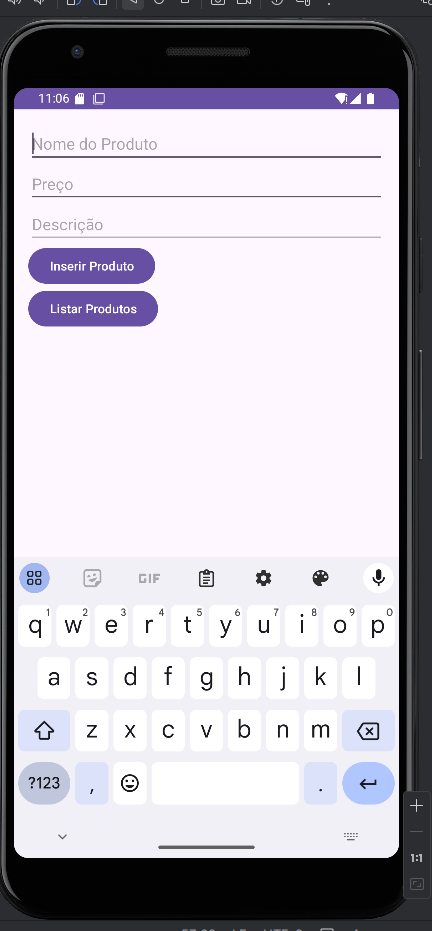
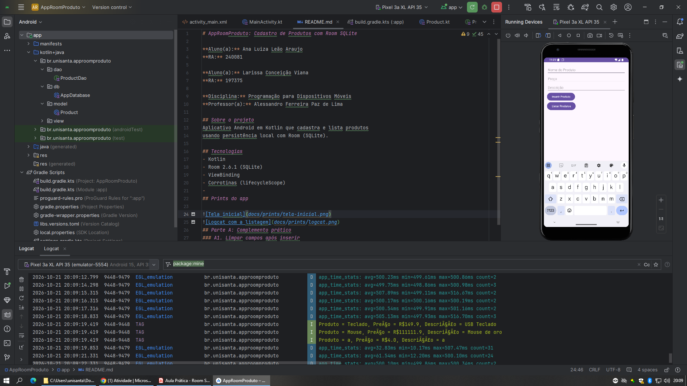
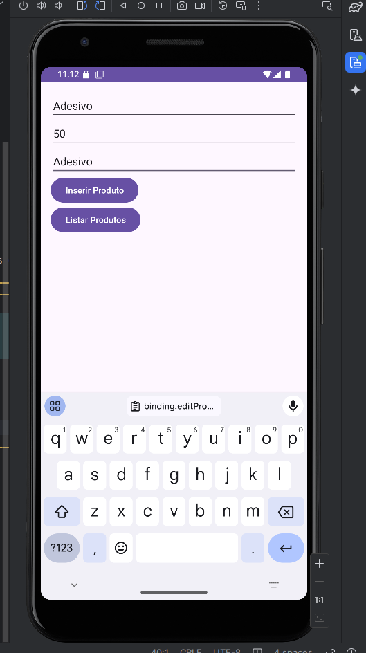
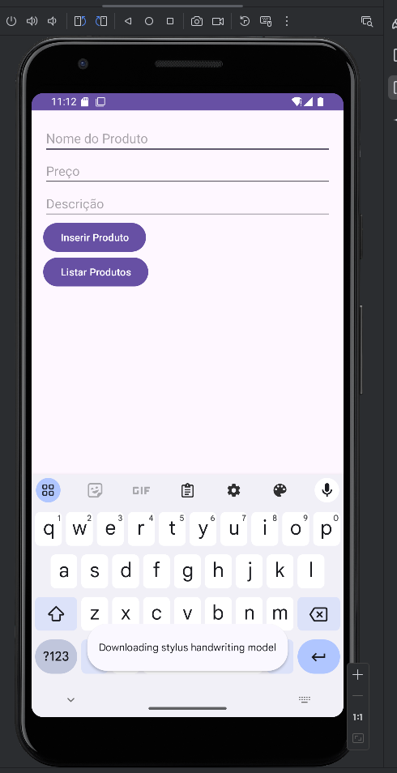
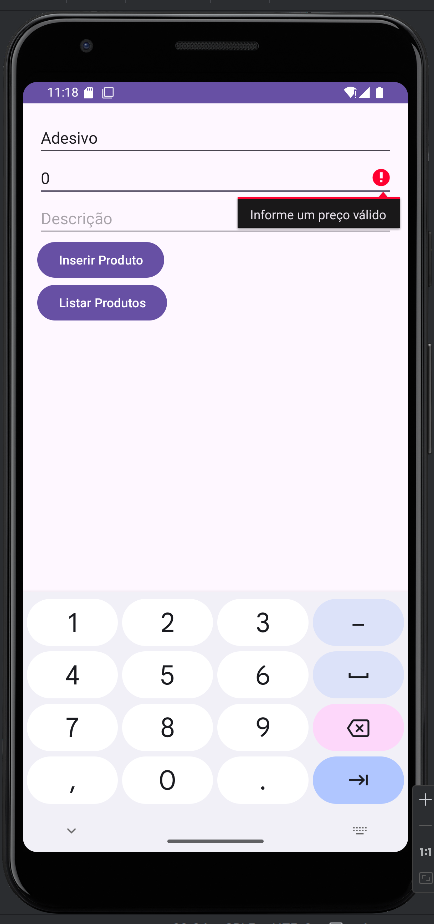
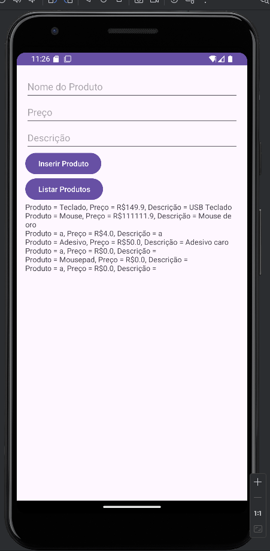
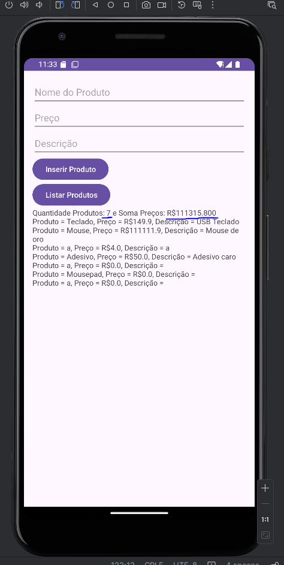
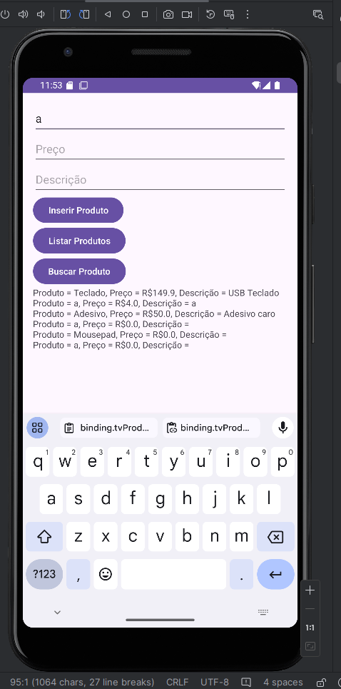
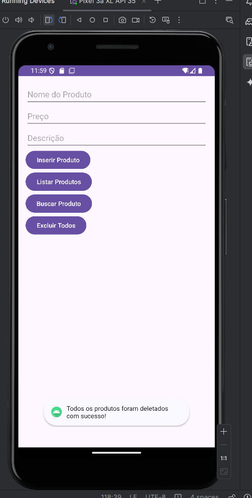
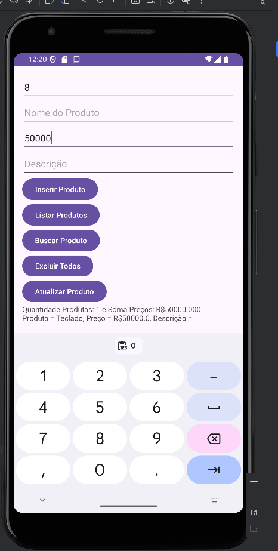

fe# AppRoomProduto: Cadastro de Produtos com Room SQLite

**Aluno(a):** Ana Luiza Leão Araujo
**RA:** 240081

**Aluno(a):** Larissa Conceição Viana
**RA:** 197375

**Disciplina:** Programação para Dispositivos Móveis
**Professor(a):** Alessandro Ferreira Paz de Lima

## Sobre o projeto
Aplicativo Android em Kotlin que cadastra e lista produtos
usando persistência local com Room (SQLite).

## Tecnologias
- Kotlin
- Room 2.6.1 (SQLite)
- ViewBinding
- Corrotinas (lifecycleScope)
## Prints do app




## Parte A: Complemento prático
### A1. Limpar campos após inserir
O que foi feito: Adicionamos no final da ação do botão "Inserir Produto" os códigos de limpar os campos e de colocar o cursor de volta no campo Nome

Trecho de código:
```kotlin
binding.editProductName.text.clear()
binding.editProductPrice.text.clear()
binding.editProductDescription.text.clear()
binding.editProductName.requestFocus()
```
Print: 
Print: 

### A2. Validação de preço
O que foi feito: Adicionado validação do preço no começo da ação do botão "Inserir Produto"

Trecho de código:
```kotlin
val price = priceText.toDouble() ?: 0.0

if (price <= 0.0)
{
    binding.editProductPrice.error = "Informe um preço válido"
}
else{
    val product = Product(name = name, price = price, description = description)

    // Insere o produto no banco de dados de forma assíncrona (usando corrotina)
    lifecycleScope.launch {
        productDao.insertAll(product)
        Log.i("TAG", "Produto inserido: $name - R$$price")
        Toast.makeText(this@MainActivity, "Produto inserido!", Toast.LENGTH_SHORT).show()
    }

    binding.editProductName.text.clear()
    binding.editProductPrice.text.clear()
    binding.editProductDescription.text.clear()
    binding.editProductName.requestFocus()
}
```
Print: 

### A3. Lista na tela
O que foi feito: Adicionamos na tela um TextView e na ação do botão btnListarProdutos uma varíavel que irá concatenar todos os produtos e inserir no TextView criado.

Trecho de código:
```kotlin
        // Exemplo de recuperação de produtos
binding.btnListarProdutos.setOnClickListener {

    // Recupera os produtos de forma assíncrona
    lifecycleScope.launch {
        val products = productDao.getAll()
        var texto = ""
        if (products.isNotEmpty()) {
            products.forEach {
                texto += "Produto = ${it.name}, Preço = R$${it.price}, Descrição = ${it.description} \n"
            }
            binding.tvProdutos.text = texto
        } else {
            Log.i("TAG", "Nenhum produto encontrado.")
        }
    }
}
```
Print: 

### A4. Total do estoque:
O que foi feito: Adicionamos na ação do botão btnListarProdutos duas variáveis uma pegando a quantidade de produtos no banco e o outro somando os preços dos produtos dentro do for. No final, juntamos essas infomações com a listagem de produtos.

Trecho de código:
```kotlin
 binding.btnListarProdutos.setOnClickListener {

    // Recupera os produtos de forma assíncrona
    lifecycleScope.launch {
        val products = productDao.getAll()
        var texto = ""
        var tamanhoEstoque = products.size
        var totalPrecos = 0.0

        if (products.isNotEmpty()) {
            products.forEach {
                texto += "Produto = ${it.name}, Preço = R$${it.price}, Descrição = ${it.description} \n"
                totalPrecos += it.price
            }

            binding.tvProdutos.text = "Quantidade Produtos: ${tamanhoEstoque} e Soma Preços: R$${String.format("%.3f", totalPrecos)} \n" + texto
        } else {
            Log.i("TAG", "Nenhum produto encontrado.")
        }
    }
}
```
Print: 

### A5. Buscar por nome
O que foi feito: Adicionamos o botão de buscar na tela e na ação dele colocamos a chamada do método buscarPorNome da DAO, após trazer os produtos relacionados, fazemos um for para montar o texto de retorno na tela.

Trecho de código:
```kotlin
binding.btnBuscar.setOnClickListener{
    val name = binding.editProductName.text.toString()

    if (name.isNotEmpty()){
        lifecycleScope.launch {
            val products = productDao.buscarPorNome("%$name%")
            var texto = ""

            products.forEach {
                texto += "Produto = ${it.name}, Preço = R$${it.price}, Descrição = ${it.description} \n"
            }

            binding.tvProdutos.text = texto
        }
    }
    else {
        Toast.makeText(this, "Preencha o nome do produto!", Toast.LENGTH_SHORT).show()
    }

}
```
Print: 

### A6. Excluir produtos
O que foi feito: Adicionamos o botão de deletar na tela e na ação dele .

Trecho de código:
```kotlin
 binding.btnExcluirTodos.setOnClickListener {
    lifecycleScope.launch {
        productDao.deleteAll()
        Toast.makeText(this@MainActivity, "Todos os produtos foram deletados com sucesso!", Toast.LENGTH_SHORT).show()
    }
}
```
Print: 

### A7. Atualizar produto
O que foi feito: Adicionamos o botão de atualizar na tela e criamos na DAO a query para atualizar o produto recebendo o id e o preço.

Trecho de código:
```kotlin
binding.btnAtualizar.setOnClickListener{
    val idText = binding.edtId.text.toString()
    val priceText = binding.editProductPrice.text.toString()
    val id = idText.toInt() ?: 0
    val price = priceText.toDouble() ?: 0.0

    if (priceText.isNotEmpty()){
        lifecycleScope.launch {
            productDao.atualizarProduto(id, price)
            Toast.makeText(this@MainActivity, "Produto atualizado!", Toast.LENGTH_SHORT).show()
        }
    }
    else {
        Toast.makeText(this, "Preencha o id e o preço novo do produto!", Toast.LENGTH_SHORT).show()
    }
}
```
Print: 

### A8. Novo campo na tabela
O que foi feito: Após a mudança todos os produtos foram deletados. Isto porque utilizamos o .fallbackToDestructiveMigration() no databaseBuilder que recria o DB se o esquema mudar.

## Parte B: Questões dissertativas
### B1. O que é persistência de dados...?
Resposta: É quando os dados persistem no app mesmo após fechá-lo. Se tivesse usado apenas uma MutableList, os dados irão sumir quando sair do aplicativo

### B2. Qual é a diferença entre usar o SQLite diretamente...?
Resposta: Usar o Room é mais fácil, pois ele simplifica todo o processo de escrever o código SQL na mão. Suas vantagens são: verificação de erros em tempo de compilação e uso de anotações simples como @Entity, @Dao e @Database.

### B3. Explique o papel de cada uma das três peças do Room?
Resposta: Entidade - Transforma classe em Kotlin em tabela do banco
DAO - Interface com os comandos do banco
Banco de dados - Vincula as entidades com os DAOs e cria o arquivo do banco

Porque foi necessário utilizar todas elas para o aplicativo funcionar devidamente.

### B4. Por que o Android não permite acessar o banco de dados na thread principal (UI thread)? O que é um ANR (Application Not Responding)? Como suspend e lifecycleScope.launch resolvem esse problema??
Resposta: Porque pode travar o app, dando o erro de ANR que é um aviso de que o aplicativo travou. Para evitar isso usamos o suspend na DAO (Indica que a tarefa pode ser pausada e retomada sem pressa) e lifecycleScope.launch na MainActivity (Abre uma segunda thread mantendo a interface sempre fluida e responsiva)

### B5. O que faz o fallbackToDestructiveMigration()? Por que ele é perigoso em um app publicado na Play Store? O que seria uma migração (*Migration*) de banco de dados?
Resposta: Ele recriar o banco se o esquema mudar. É super perigoso para apps reais na Play Store porque, se atualizar o app, o usuário perde todos os dados salvos. O jeito certo seria criar um script que atualiza o banco passo a passo sem apagar as coisas dos usuários.

### B6. Qual é a vantagem do ViewBinding em relação ao findViewById? Que tipo de erro ele ajuda a evitar??
Resposta: O ViewBinding deixa a gente acessar os elementos da tela de forma muito mais limpa, sem precisar ficar chamando ⁠findViewById⁠ pra tudo. Ele evita principalmente aquela dor de cabeça com exceção de null.

### B7. No tutorial, o banco é criado dentro da MainActivity. Por que em apps maiores é recomendado criar o banco como Singleton (uma única instância para o app inteiro)? O que poderia acontecer se várias telas criassem cada uma o seu banco?
Resposta: Porque em app grande a gente quer economizar memória e evitar conflitos. Se cada tela criasse a sua própria instância do banco, o app ia ficar pesado e muito lento.

### B8. Reflexão pessoal: quais foram as principais dificuldades que você teve neste projeto e como as resolveu? Cite um app real (de comércio, estoque, saúde, escola etc.) em que a persistência local com Room seria útil e explique como você o aplicaria.
Resposta:A minha maior dificuldade inicial foi entender a necessidade das corrotinas suspend e lifecycleScope para o app não travar a tela. No fim, deu tudo certo organizando direitinho os pacotes. Um app real onde o Room seria perfeito é um app de controle de estoque para uma mercearia local, permitindo registrar produtos e consultar preços mesmo sem internet.

